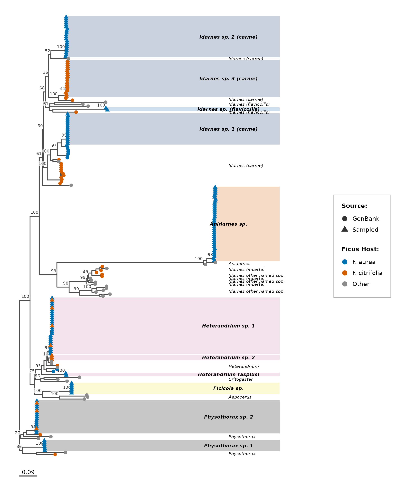
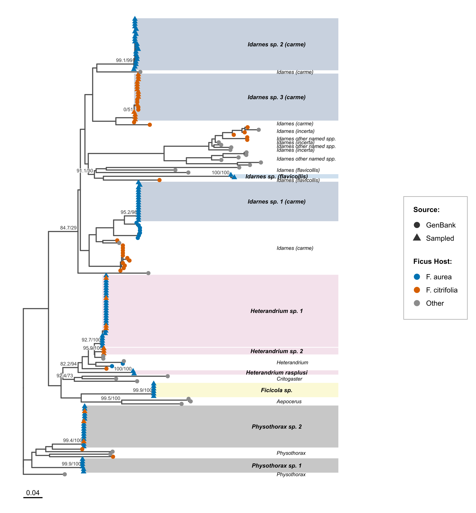
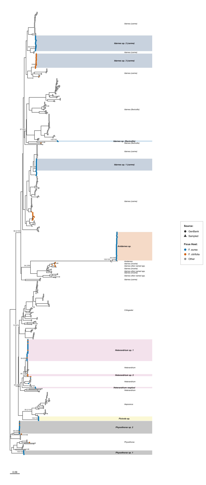

## Abstract
In tightly coupled ecological interactions such as mutualisms, cryptic diversity can obscure partner diversity, complicating how we study and interpret species interactions and community structure.
Florida hosts the only two fig species native to the continental United States, *Ficus aurea* and *F. citrifolia*, whose pollinating and non-pollinating fig wasp (NPFW) communities have been described ecologically but remain largely uncharacterized with molecular data.
We combined field sampling, molecular barcoding (cytochrome c oxidase subunit I, COI), and host population genomics to reassess this community.
Using morphology-based identifications of NPFWs from 500 syconia, we found that co-occurrence in *F. aurea* departed from random for five species pairs, three of which co-occurred less often than expected, consistent with competition or trophic interactions among NPFWs.
COI sequences from 98 pollinators and 160 NPFWs revealed cryptic mtDNA lineages within the pollinators *Pegoscapus mexicanus* (ex *F. aurea*) and *P. franki* (ex *F. citrifolia*), and within the NPFW taxa *Idarnes* (carme group), *Heterandrium*, and *Physothorax*.
Barcoding also identified *P. franki* developing in *F. aurea* syconia, consistent with heterospecific pollination.
Whole-genome data from 12 *Ficus* individuals separated the two host species and identified one *F. aurea* individual with ~16% *F. citrifolia* ancestry, consistent with introgression in the same direction as pollinator sharing.
Together, these results show that even this species-poor fig–wasp system harbors more cryptic diversity and more permeable host boundaries than morphology alone suggests, and highlight the need for genome-wide data and denser sampling to resolve coevolutionary dynamics in the fig–fig wasp mutualism.

## Introduction

Close ecological associations such as mutualism and parasitism are central to community function and have profoundly influenced the diversification and organization of life on Earth [@Thompson1994; @Futuyma1983; @BronsteinAlarcon2006; @Leigh2010].
These interactions often involve high levels of intimacy and partner specificity, generating reciprocal selection pressures that shape population dynamics, adaptation, and long-term coevolutionary trajectories [@Thrall2007].
In some cases, such reciprocal pressures lead to co-speciation of the interacting partners [@Demastes1993; @Pellmyr1999; @DeVienne2013; @Hafner1988].

Mutualisms are shaped by a balance of conflict and cooperation between partners [@Herre1999; @carlson2022evolution], and the boundary between mutualism and parasitism often falls along a continuum [@Thrall2007].
Partner diversity and specificity can therefore affect the evolutionary stability of these relationships [@carlson2022evolution], making the number of species involved in a host-symbiont interaction central to understanding the evolutionary dynamics of close ecological associations.
However, cryptic species can lead to underestimated partner diversity and misjudged specificity [@Bickford2007; @Darwell2014; @Darwell2017].
Cryptic species that share an environment or host are not necessarily ecologically equivalent; they may compete for or partition the same resources and differ in their effects on host fitness [@Bickford2007; @Sampayo2008].
Treating multiple cryptic species as a single species assumes ecological equivalence [@LeiboldMcPeek2006] and masks competition that can shape resource allocation, host exploitation, partner fitness and community structure.
Geographic variation in partner specificity adds another layer of complexity [@Darwell2014; @Deng2021].
Without accurate estimates of partner diversity and sufficient taxonomic resolution, community structure can be missed, limiting inference of coevolution in complex symbiotic networks.
Fig trees and their associated wasps provide a model system for addressing these questions.

The obligate nursery-pollination mutualism between fig trees (*Ficus*) and their pollinating fig wasps is a classic system for studying coevolution [@Weiblen2002; @Janzen1979; @Borges2015; @herre2008evolutionary].
The two partners have tightly interdependent life cycles, in which pollinating wasps depend on receptive syconia (figs) for brood development, while fig trees depend on the wasp for pollination [@Janzen1979].
This interdependence is sustained by fig reproductive phenology: asynchronous but continuous fruiting among trees, and in some species within trees, provides a steady supply of receptive syconia that allows short-lived pollinator populations to persist [@Bronstein1990; @McKey1989; @BronsteinPatel1992Temperature; @BronsteinPatel1992Phenology; @Krishnan2014].
Figs have also evolved elaborate floral fragrances that attract species-specific pollinators, allowing female wasps to locate receptive host trees often several kilometers from their natal fig and thereby promoting long-distance pollen dispersal [@Nason1996; @ChenSong2008; @Wang2013; @Ahmed2009].
Each of the ~850 *Ficus* species is typically pollinated by a single wasp species, but these one-to-one relationships are less strict than previously thought. 
Many hosts support multiple pollinators, including cryptic species, so fig wasp diversity likely exceeds that of their hosts [@Yu2019; @Yu2021; @Su2008; @Yang2015; @Machado2005; @Molbo2003].
Cryptic pollinators can co-occur in the same tree and even within the same syconium [@Molbo2003; @sutton2017local].
Host switching and sharing are key dynamics shaping fig–pollinator evolution, and heterospecific pollination by shared or host-switching pollinators can lead to hybridization and introgression between fig species [@Machado2005; @Wang2021; @Satler2023; @Gardner2023].
Host sharing also occurs among the non-pollinating fig wasps (NPFWs) that exploit the mutualism [@Marussich2007].

Figs are exploited by a diverse assemblage of NPFWs that develop within fig resources without providing pollination services [@Borges2015].
These include gallers, parasitoids, kleptoparasites, and hyperparasitoids [@farache2018insights; @barros2025solving; @barros2025drill] from multiple chalcid families, with some species restricted to a single fig species and others using multiple hosts [@farache2018insights; @Satler2020; @Deng2021; @Conchou2014; @Marussich2007; @farache2024tale].
NPFWs can significantly influence fig reproductive success, fig–pollinator interactions, and the stability of the mutualism [@Lin2025; @Conchou2014; @West1994; @Cruaud2011; @Cardona2019].
Fig trees can enforce cooperation through host sanctions, aborting or reducing resource allocation to syconia that are not pollinated, which lowers the reproductive success of wasps developing within them [@Jander2016].
Because NPFWs do not pollinate, those developing in unpollinated syconia are exposed to these sanctions; however, some early-ovipositing gallers can prevent abortion and drive unpollinated syconia to maturity [@Krishnan2014], and the extent to which other NPFWs bypass host sanctions remains unclear.
Like pollinators, NPFWs harbor cryptic diversity, and co-occurring species can partition oviposition timing and ovule layers [@Satler2020] or show distributions consistent with competition among functionally similar species [@Darwell2017].
Because fig wasp species differ in their effects on the host, including seed production [@Zhang2021] and syconium development time [@Krishnan2014], identifying which species are present is necessary to understand how the wasp community shapes the mutualism.
Yet NPFW diversity remains poorly documented, leaving key gaps in our understanding of their evolution, speciation, and ecological roles.

Florida harbors the only two native *Ficus* species documented in the continental United States: *F. aurea* Nutt. and *F. citrifolia* Mill. [@Conduit1969], along with naturalized populations of, *F. benghalensis* L., *F. microcarpa* L.f., and *F. altissima* Blume [@Nadel1992; @Conduit1969; @Caughlin2012].
With only two native hosts and a small set of associated wasps, this community offers a tractable system for studying how partner diversity shapes the mutualism. 
The ecology of Florida's native fig-fig wasp was described in detail three to four decades ago [@Stange1987; @Bronstein1999; @Nadel1992; @BronsteinHossaertMcKey1995; @BronsteinPatel1992Temperature; @BronsteinHossaertMcKey1996], but molecular resources remain scarce or absent for most associated wasp species.
As a result, species boundaries in these communities rest almost entirely on morphology and the extent of cryptic diversity and host sharing is unknown.
Here, we reassess the fig wasp communities associated with *F. aurea*, *F. citrifolia*, and *F. benghalensis* in Florida.
First, we characterize community composition and species co-occurrence within syconia using current morphology-based identifications.
Second, we use cytochrome c oxidase subunit I (COI) barcoding to delimit pollinator and NFPW species, and test whether morphologically defined species contain cryptic lineages.
Third, we present population genomic analysis of *F. aurea* and *F. citrifolia* to describe host population structure and genetic diversity.
Our results show that the Florida fig wasp community is more diverse than previously recognized and provide a detailed assessment of fig-fig wasp assemblages with implications for native Florida *Ficus* introgression
<!-- identify open questions about host sharing, introgression, and coevolution that future studies in this system can address.-->

## Methods

### Field Sampling

We collected and geo-referenced *Ficus* individuals across southern Florida over three sampling years (2024, 2025, 2026).
For trees bearing syconia, we collected fewer than 40 syconia per individual or no more than 20% of the total syconia, whichever was less.
Syconia were kept at room temperature to facilitate the natural emergence of fig wasps.
Syconia were classified as pollinated based on the natural emergence of pollinating wasps and confirmation of a foundress carcass following pollinator emergence.
If no pollinators had naturally emerged after three days, syconia were cut open to verify whether pollinators were present.
If pollinators were present but had not emerged naturally, the syconia was still classified as pollinated and foundress carcasses were counted.
A fig was classified as unpollinated based on the absence of pollinators and foundress carcasses.
After emergence, the wasps were cooled at 4 °C to induce a state of lethargy, then euthanized and preserved.
Leaf samples were cleaned of excess latex, and assigned unique identifiers.
Leaf tissue was desiccated for preservation using color-indicating silica gel for subsequent molecular analysis.
Samples were transported to the University of Maryland for processing and identification.

Wasp specimens were identified to the lowest possible taxon with the help of fig wasp taxonomist Fernando Henrique Farache (Instituto Federal Goiano, Brazil).
Individuals were sorted by morphospecies and host associations.
Representative images were captured for each identified morphospecies, and further molecular analyses were conducted for verification.
Collection statistics, summary metrics, and figures were generated using custom R script [@RCoreTeam2025].
Confidence intervals for mean foundress number were estimated using a clustered bootstrap that resamples trees and then figs within trees, propagating both within- and between-tree variation.

### Fig Wasp Community Structure

All community analyses treated the individual syconium as the sampling unit and were restricted to morphospecies of NPFW diagnosable from female morphology.
Males were excluded because they cannot be assigned unambiguously to a female morphospecies and could artifactually co-occur with their own species.
We considered abundance (number of females per fig) and/or occurrence (presence/absence per fig).
Because syconia were sampled repeatedly from the same trees and are therefore not independent, tree was included as a random effect in the richness models; the pollination and co-occurrence analyses treated syconia as independent.

We recorded foundress number because it determines how many pollinator females, and potentially how many lineages, contribute to a single brood.
Foundress abundance per syconia was recorded in 2026 for *F. aurea* and *F. citrifolia.*
Each syconia was tallied into bins of 1-5.
We had an additional bin classified as 6+, which was scored as 6, so means are slightly conservative.
For each host we calculated the average foundress number among syconia and the proportion of single-foundress figs with a Wilson 95 \\% confidence interval.

#### NPFW frequency, abundance and species richness

To characterize and compare NPFW communities between the two native hosts, we calculated the frequency of each morphospecies as the percentage of syconia in which it was present and its abundance as the mean number of female NPFWs per occupied syconium.
Species richness per syconium was calculated as the number of NPFW morphospecies present, based on females, and is reported as a mean.
We compared species richness between *F. aurea* and *F. citrifolia* wasp assemblages using a Conway-Maxwell-Poison generalized linear mixed model (R package`glmmTMB`) with host species as a fixed effect and trees as a random intercept to accommodate underdispersion [@sellers2010flexible; @Brooks2017].

#### NPFW association with pollinator presence

To test whether pollination status affects NPFW reproduction, we compared the occurrence of each NPFW morphospecies between pollinated and unpollinated *F. aurea* syconia collected in 2026 using Fisher's exact tests.
Abundance was modelled as a function of pollination status using Poisson generalized linear models, replaced by negative binomial models where over dispersion was high.
We only tested NPFW taxa with adequate sample sizes: *Idarnes* sp. (*carme*), *Physothorax* sp. 1, *Physothorax* sp. 2, *Anidarnes* sp., *Heterandrium* sp., and *Heterandrium rasplusi*.

#### Co-occurrence among NPFW morphospecies

To test whether NPFW morphospecies co-occur within syconia more or less often than expected by chance, we tested pairwise associations for each host, pooling all sampling years.
We analyzed NPFWs from *F. aurea* and *F. citrifolia* separately because pooling them can generate spurious associations through shared host preference.
In each analysis, a site was a syconium containing at least one female NPFW morphospecies.
Occurrence-based associations were assessed with the probabilistic co-occurrence model[@Veech2013] implemented in base R using a custom script.
Abundance-based associations were assessed with Spearman rank correlations of per-fig counts.
We controlled the false discovery rate across all testable pairs using the Benjamini–Hochberg procedure and pairs were classified positively or negatively associated when q \< 0.05 and as random otherwise.

### Sanger Sequencing and Phylogenetic Analysis of Fig Wasps

To test whether morphologically defined species contain cryptic lineages, we used the mitochondrial cytochrome c oxidase subunit I (COI) region as a molecular barcode to delimit species.
The whole-body genomic DNA of each morphospecies was extracted using the Omega Bio-tek E.Z.N.A.® Insect and Mollusk DNA Kit (Omega Bio-tek, Georgia, United States), following the manufacturer’s protocol.
The COI region was amplified by PCR using separate protocols for pollinating and non-pollinating wasps.
For pollinators, the primers NewCOI_DEG_668_F (CTCTGGRGGKGGTGATCCAA) and NewCOI_DEG_1171_R (AAAATWGCATANACWGCNCCTA) were used to amplify a fragment of approximately 500 bp [@Oldenbeuving2023].
To improve sequencing quality, we added primer M13(-21) (5’-TGTAAAACGACGGCCAGT-3’) to the 5’ end of NewCOI_DEG_668_F and primer M13R (5’-CAGGAAACAGCTATGAC-3’) to the 5’ end of NewCOI_DEG_1171_R. In contrast, for non-pollinators, the primers New Jerry (5’-TTGATTTTTTGGTCATCCAGAAGT-3’) and New Pat (5’-TCCAATGCACTAATCTGCCAT-3’) were used directly without M13 tails, producing a clean fragment of approximately 800 bp [@Marussich2007].
For pollinator PCR conditions, the protocol involved an initial denaturation at 94 °C for 1:30 minutes, followed by 36 cycles of denaturation at 94 °C for 30 seconds, annealing at 57 °C for 25 seconds, and extension at 72 °C for 30 seconds, with a final extension at 72 °C for 5 minutes.
For non-pollinator PCR conditions, the initial denaturation was at 94 °C for 1:30 minutes, followed by 42 cycles of denaturation at 94 °C for 30 seconds, annealing at 51 °C for 25 seconds, and extension at 72 °C for 1:10 minutes, with a final extension at 72 °C for 5 minutes.
PCR products were verified on a 1% agarose gel to confirm amplification of the expected fragment size.
The PCR products were then purified with AMPure XP beads following the manufacturer’s protocol.
Purified DNA products were quantified using fluorometry with the Qubit HS assay (Thermo Fisher Scientific).

Automated Sanger sequencing was conducted at Genewiz (New Jersey, United States).
The resulting chromatogram files were manually inspected and trimmed using FinchTV [@Geospiza2006].
Only sequences at least 400 bp long were retained after trimming.
To verify species identification of morphospecies and assess phylogenetic relationships, we obtained published COI sequences for pollinators and non-pollinators [@Marussich2007].
Phylogenetic analyses were conducted separately for pollinators and non-pollinators, using *Tetrapus* as the outgroup for the pollinator and *Physothorax* as the outgroup for the NFPW.
Sequences were aligned with MAFFT using the -linsi option [@Katoh2002; @Katoh2013], and trimmed using trimAl [@CapellaGutierrez2009].
Maximum-likelihood phylogenetic analysis was performed in IQ-TREE 3 [@wong2026iqtree]; we selected the optimal nucleotide substitution model using ModelFinder [@Kalyaanamoorthy2017].
Branch support was assessed using 1,000 ultrafast bootstrap replicates [@hoang2017ufboot].
We plotted phylogenetic trees using the R packages ggtree and ape [@Yu2017; @Paradis2004], and used the resulting phylogenies inform species delimitation.

### Population genomics of *Ficus aurea* and *F. citrifolia*

To describe population structure and genetic diversity in the two native hosts, we generated whole-genome resequencing data for *F. aurea* and *F. citrifolia*.
Fig genomic DNA was extracted from silica-dried leaf tissue of eight *F. aurea* and four *F. citrifolia* individuals using the DNeasy Plant Pro Kit (Qiagen, Hilden, Germany) following the manufacturer's protocol.
Sequencing libraries were constructed with the NEBNext Ultra II FS DNA Library Prep Kit for Illumina (New England Biolabs, Ipswich, MA) with a target insert size of 300–500 bp.
Libraries were pooled in equimolar amounts and sequenced by Ampseq (Gaithersburg, MD) on the Element AVITI platform using a 2 × 150 bp high output flow cell.
Raw reads were trimmed with fastp v1.0.1 [@Chen2018] using default parameters.
Trimmed reads were mapped to a chromosome level *Ficus carica* reference genome (unpublished) using Parabricks fq2bam v4.4.0-1, a GPU-accelerated implementation of BWA-MEM [@Li2013] that performs duplicate marking.
Variants were called per sample with DeepVariant v1.8.0 in WGS mode [@Poplin2018], and per-sample gVCFs were jointly genotyped across all samples with GLnexus under the DeepVariantWGS configuration [@Yun2021].
Biallelic SNPs were retained with bcftools (-m2 -M2 -v snps; [@Danecek2021]).
No base quality score was applied because no curated set of known variants is available for *Ficus*.
Quality metrics were compiled with FastQC, bamtools, Qualimap, bcftools, and MultiQC [@Andrews2010; @Barnett2011; @Okonechnikov2016; @Ewels2016; @Cardona2019].
All steps were executed in Singularity containers via a Snakemake workflow (see Data Availability).

The joint SNP set was filtered with VCFtools [@Danecek2011] to remove sites with QUAL \< 20, minor allele frequency \< 0.05.
The filtered VCF was converted to PLINK binary format (PLINK v1.9; [@Chang2015]), with half-calls set to missing (\`--vcf-half-call m\`), and pruned for linkage disequilibrium in windows of 50 variants advanced in 10 variant steps at an r² threshold of 0.1 (--indep-pairwise 50 10 0.1).
Population structure was assessed on the LD-pruned dataset in two ways.
Principal component analysis was performed using snpgdsPCA in SNPRelate [@Zheng2012], retaining the first three components.
Ancestry coefficients were estimated by sparse non-negative matrix factorization in LEA [@Frichot2015], across K = 1–10 with 20 replicates per K under default settings; the optimal K was selected as the value minimizing cross-entropy.
Results were plotted in R with *ggplot2* [@Wickham2016].

## Results

### *Ficus* community composition

*Ficus aurea* is the more common of the two native figs in southern Florida.
Across three collection years we sampled 299 *F. aurea*, 27 *F. citrifolia* and 16 *F. benghalensis* trees.
Morphological sorting identified three pollinators and eight NPFW morphospecies.
F. aurea and *F. citrifolia* were each associated with a distinct *Pegoscapus* morphospecies, and *F. benghalensis* with *Eupristina masoni*, consistent with published records [@Stange1987; @Nadel1992].

In the 2026 collection, mean foundress number was 1.45 (95% CI 1.06-1.71; 117 syconia from six trees) in *F. aurea* and 1.86 (95% CI 1.60-2.12; 49 syconia from a single tree) in *F. citrifolia* (@fig-foundress A).
Single-foundress broods predominated in *F. aurea* (@fig-foundress B).
Single-foundress broods were also the most common in *F. citrifolia*, but broods with two or three foundresses were nearly as frequent.
The *F. citrifolia* estimate comes from one tree, so its confidence interval reflects only among-fig variation and is not directly comparable to the tree-resampled interval for F. aurea.

{#fig-foundress}

### NPFW community composition and richness

No NPFW emerged from F. benghalensis syconia.
Thus, all analyses present below cover only the two native hosts.
Of the eight NPFW morphospecies found in *F. aurea*, only seven occurred in *F. citrifolia*, with Anidarnes bicolor exclusive to *F. aurea* (@fig-npfw-abundance).
Mean NPFW species richness per syconium was higher in *F. aurea* than in *F. citrifolia* (2.14 ± 1.12 vs. 1.33 ± 0.64 morphospecies; n = 454 and 46 syconia, respectively).
However, richness did not differ significantly between hosts once we accounted for syconia from the same tree not being independent (GLMM with tree as a random effect; rate ratio \[*F. citrifolia : F. aurea*\] = 0.86, 95% CI 0.60–1.23, p = 0.40).

In *F. aurea*, *Idarnes sp. (carme)* was both the most frequent and the most abundant NPFW.
It occurred in 253 syconia (55.7%) with a mean of 7.68 ± 8.00 individuals per occupied syconium.
The next most frequent were *Heterandrium sp.* (198 syconia, 43.6%; 2.90 ± 2.66), *Physothorax sp. 2* (181, 39.9%; 2.90 ± 2.27), *Anidarnes sp.* (176, 38.8%; 4.74 ± 4.11) and *Physothorax* sp. 1 (90, 19.8%; 2.66 ± 2.57) (@fig-npfw-abundance).
In *F. citrifolia*, *Heterandrium sp.* was the most frequent NPFW (42 syconia, 77.8%; 2.76 ± 2.64 individuals).
It was followed by *Idarnes sp. (carme)* (14, 25.9%; 5.43 ± 7.07) and *Physothorax sp. 2* (9, 16.7%; 1.67 ± 1.32).
The remaining morphospecies were rare in both hosts (@tbl-npfw).

{#fig-npfw-abundance}

### NPFW and pollinator presence

Most NPFW morphospecies developed in both pollinated and unpollinated *F. aurea* syconia (@tbl-npfw-poll-presence and @tbl-npfw-poll-ratio).
Of the six NPFW taxa tested, only *Physothorax sp. 2* differed in occurrence. 
It occurred less often in pollinated figs than in unpollinated figs (23.8% vs. 41.3%; Fisher's exact test, odds ratio = 0.45, p = 0.031).
The remaining taxa showed no significant association with pollination status, although
*Idarnes sp. (carme)*, *Anidarnes sp.*, *Heterandrium sp.* and *Heterandrium rasplusi* tended to occur more often in pollinated figs and *Physothorax sp. 1* in unpollinated syconia.
Pollination status also affected abundance in only one taxon: *Idarnes sp. (carme)* produced fewer offspring in unpollinated than in pollinated syconia (unpollinated/pollinated ratio = 0.63, p = 0.005; @tbl-npfw-poll-ratio), suggesting that its reproductive success depends partly on pollination.
No other taxon differed in abundance, although small sample sizes may have limited statistical power.
In contrast, NPFWs in *F. citrifolia* never developed without pollinators: all syconia containing NPFWs also contained pollinators, and none of the [N] unpollinated syconia produced NPFWs.
Thus, NPFWs can develop in unpollinated syconia of *F. aurea* but not of *F. citrifolia*.

### NPFW co-occurrence

Across all sampling years, non-pollinating fig wasps were scored in 454 *F. aurea* syconia, of which 270 (59.7%) contained at least two or more morphospecies, yielding pairs with an expected co-occurrence ≥ 1 that were testable under a probabilistic model.
After Benjamini–Hochberg correction, five pairs departed significantly from random, independent colonization: three co-occurred less often than expected and two more often than expected.
The strongest signal was a segregation involving the interfloral phase ovule galler *Idarnes sp.* (carme), which shared fewer syconia than expected with the early gall inducer *Ficicola sp.* (8 observed vs. 20.6 expected; q = 2.4 × 10⁻⁴) and with *Physothorax sp. 2* (60 vs. 80.2; q = 3.6 × 10⁻⁴), and a third segregation between *Anidarnes sp.* and *Heterandrium* sp.* (49 vs. 62.7; q = 0.024).
The two positive associations were *Anidarnes sp.* with *Ficicola sp.* (21 vs. 12.6; q = 0.022) and *Physothorax sp. 1* with *Physothorax sp. 2* (30 vs. 20.4; q = 0.026).
The abundance-based analysis corroborated four of these five pairs with significant Spearman correlations of matching sign (*I. sp. (carme)* × *Ficicola sp.*, ρ = −0.21, q = 9.1 × 10⁻⁵; *I. sp. (carme)* × *Physothorax sp. 2*, ρ = −0.21, q = 9.1 × 10⁻⁵; *Anidarnes sp.* × Heterandrium sp., ρ = −0.13, q = 0.027; *Anidarnes sp.* × *Ficicola sp.*, ρ = +0.15, q = 0.013).
The *Physothorax* sp. 1 × sp. 2 aggregation was positive but only marginal by this measure (ρ = +0.10, q = 0.067).
All remaining pairs were statistically indistinguishable from random.

In *Ficus citrifolia*, sampling was sparser (46 syconia, 10 with ≥ 2 morphospecies, seven species, five testable pairs).
A single association was significant after correction: *Idarnes sp. (carme)* and *Heterandrium sp.* co-occurred less often than expected (5 vs. 10.3; q = 1.3 × 10⁻³), a segregation strongly supported by the abundance data (ρ = −0.51, q = 1.3 × 10⁻³).
No pair showed a significant positive association in this host.
Due to the limited sample size these results should be interpreted with caution.

### Phylogenetic Analysis of Fig Wasps

We amplified and sequenced COI for 98 pollinators and 160 non-pollinators (NPFW).
Due to limited sample sizes, not all morphospecies from each ***Ficus*** host could be sequenced.
Specimens, particularly from rare morphospecies, failed to amplify or yielded poor quality sequences.
COI phylogenetic analyses revealed several discrepancies between the morphology-based taxon identification and molecular species delimitation for both pollinating and non-pollinating wasps, but more importantly we detected multiple morphospecies harboring previously unreported cryptic diversity (@tbl-coi-seq).
Both the pollinator and non-pollinator phylogenies were well resolved, and higher-level relationships were largely consistent with those reported in previous studies [@Marussich2007; @Cruaud2011; @Cruaud2013; @cruaud2023chalcidoidea].
One notable exception occurred in the non-pollinator phylogeny.
The *Idarnes incertus* group was recovered as sister to *Anidarnes*, whereas published topologies based on mitochondrial and nuclear markers place it as sister to the *I. flavicollis* group [@Cruaud2011].
Additionally, *Idarnes carme* group was also paraphyletic.
To test whether our topology is statistically distinguishable from @Cruaud2011, we compared the unconstrained maximum-likelihood (ML) tree with a constrained tree that enforced *Idarnes carme* monophyly and placed Anidarnes as sister to *Idarnes* using the approximately unbiased (AU) test [@shimodaira2002approximately].
The constrained topology had a lower log-likelihood than our unconstrainted ML tree (ΔlnL = 23.1) but was not significantly rejected (p-AU = 0.13; α = 0.05).
Because our dataset comprises many individuals but only \~500 bp of a single mitochondrial locus, the likelihood difference between topologies is subject to substantial sampling variance, and a ΔlnL of this magnitude is not large relative to that variance.
In addition, *Anidarnes* occupies a long branch and our COI alignment provides few sites relative to the number of individuals, so we cannot exclude long-branch attraction.
Our COI data alone therefore cannot statistically distinguish our topology from the @Cruaud2011, and additional loci will be needed to resolve the placement of *Anidarnes*.

| Ecological Role | Species | Lineage Basis | N | Fig Host |
|---------------|---------------|---------------|---------------|---------------|
| Pollinator | Eupristina masoni | Morphospecies | 18 | F. benghalensis |
|  | Pegoscapus franki A | COI lineage | 5 | F. aurea |
|  | Pegoscapus franki A | COI lineage | 44 | F. citrifolia |
|  | Pegoscapus franki B | COI lineage | 3 | F. citrifolia |
|  | Pegoscapus mexicanus A | COI lineage | 23 | F. aurea |
|  | Pegoscapus mexicanus B | COI lineage | 5 | F. aurea |
| Non-Pollinator | Anidarnes bicolor | Morphospecies | 38 | F. aurea |
|  | Ficicola sp. | Morphospecies | 6 | F. aurea |
|  | Heterandrium rasplusi | Morphospecies | 2 | F. aurea |
|  | Heterandrium sp. 1 | COI lineage | 25 | F. aurea |
|  | Heterandrium sp. 1 | COI lineage | 4 | F. citrifolia |
|  | Heterandrium sp. 2 | COI lineage | 3 | F. citrifolia |
|  | Idarnes sp. (flavicollis group) | Morphospecies | 2 | F. aurea |
|  | Idarnes sp. 1 (carme group) | COI lineage | 16 | F. aurea |
|  | Idarnes sp. 2 (carme group) | COI lineage | 21 | F. aurea |
|  | Idarnes sp. 3 (carme group) | COI lineage | 15 | F. citrifolia |
|  | Physothorax sp. 1 | Morphospecies | 6 | F. aurea |
|  | Physothorax sp. 2 | Morphospecies | 14 | F. aurea |
|  | Physothorax sp. 2 | Morphospecies | 3 | F. citrifolia |

: Pollinating and non-pollinating fig wasp species associated with *Ficus aurea*, *F. citrifolia*, and *F. benghalensis*. Species are listed with their lineage basis (morphospecies or COI lineage) and the number of specimens (N) per host used for mtDNA barcoding and phylogenetic analysis. {#tbl-coi-seq}

Among pollinators (Agaonidae: Agaoninae), the phylogeny placed *Eupristina masoni* as sister to *Pegoscapus*.
Pollinators of *F. aurea* and *F. citrifolia* were resolved as distinct clades within *Pegoscapus*, nested among other congeneric species (@fig-pol-phylo).
*Ficus citrifolia* in Florida hosts two morphologically similar species that form distinct, well-supported clades: a common species, *P. franki A*, and a rarer, genetically distinct sister lineage, *P. franki* B. Several individuals identified as *P. franki* A were collected from *F. aurea* syconia, where they had successfully oviposited and completed development to adulthood, indicating occasional heterospecific pollination events.
*Ficus aurea*, in contrast, is pollinated by two species that are not sister taxa, indicating at least one host switch rather than in-situ diversification: *P. mexicanus* A is the predominant pollinator, while the less common *P. mexicanus* B is more closely related to *P. tonduzi*, the pollinator of *F. citrifolia* in Panama.
*F. benghalensis* is pollinated by a single species, *Eupristina masoni*, with no evidence of cryptic lineages.
Species boundaries inferred for *P. franki* and *P. mexicanus* are additionally supported by unpublished whole-genome data, which independently confirm the mitochondrial species-delimitation results (Zhao et al. in prep).

![Maximum likelihood (ML) phylogenetic tree of fig wasp pollinator species inferred from mitoDNA (COI), including samples from this study and published sequences. A few pollinators collected from *F. aurea* syconia (blue) cluster within the *F. citrifolia* pollinator (*P. franki*) clade suggesting that *F. citrifolia* pollinators had entered *F. aurea* syconia, successfully pollinated them, and completed larval development within the host fig. This cross-host occurrence provides phylogenetic and ecological evidence consistent with occasional heterospecific pollination and potential pollen-mediated gene flow from *F. citrifolia* into *F. aurea*. Node support values indicate UFBoot for selected nodes.](figures/178_pollinator_species_phylogeny_pruned.png){#fig-pol-phylo}

For NPFW, molecular species delimitation was largely concordant with morphological identification, although several morphospecies also proved to harbor cryptic diversity (@fig-nfpw-phylo).
*Anidarnes bicolor* (family Petromalidae) formed a monophyletic clade sister to the rest of the NPFW samples.
As noted above, A. bicolor was recovered as a sister clade to the Idarnes incertus group which is inconsistent with previously published studies.
However, *A. bicolor* sits on a very long branch and this placement should be interpreted with caution as it may be the result of long-branch attraction.
The remaining *Idarnes* species (family Pteromalidae) formed a monophyletic clade sister all other sampled genera: *Heterandrium* (family Pteromalidae, galler), *Physothorax* (family Torymidae), and *Ficicola* (family Pteromalidae), reflecting the taxonomic diversity of gallers, kleptoparasites, and parasitoids associated with Ficus syconia [@barros2025solving].

Within this topology, *Physothorax sp. 1* and *sp. 2* each formed a single, well-supported monophyletic clade; both species appear to utilize F. aurea and F. citrifolia syconia, although COI amplification failed for *F. citrifolia* samples.
Heterandrium showed strong host structuring: Heterandrium sp. 1 was recovered from both F. aurea and F. citrifolia, whereas *Heterandrium sp. 2* was restricted to *F. citrifolia*.
H. rasplusi formed a third clade recovered only from *F. aurea*, as COI amplification failed for *F. citrifolia* samples.
Ficicola sp. and *Idarnes sp. (flavicollis)* each resolved as a single, well-delimited species, however small sample sizes limited amplification success to *F. aurea* specimens.

The species complex *Idarnes sp.* (carme) exhibited the greatest cryptic diversity among the NPFW samples.
Individuals collected from F. aurea resolved two distinct clades, *Idarnes sp. 1* and *sp. 2*.
Idarnes sp. 1 is more closely related to the *Idarnes* lineage associated with F. aurea from Panama, whereas Idarnes sp. 2 is more closely related to an *Idarnes* lineage associated with *F. costaricana* (@fig-nfpw-phylo).
Idarnes sp 3. is solely associated with *F. citrifolia* in Florida and is distantly related to both *F. aurea Idarnes* species from Florida.
Additionally, Idarnes sp 3. is also distantly related to the *Idarnes* associated with *F. citrifolia* in Panama.
Overall, Idarnes from *F. aurea* and *F. citrifolia* represent distinct species.
Collectively, these results indicate that cryptic diversity within Florida's fig wasp community, among both pollinators and NPFW, exceeds current estimates based on morphology alone.

{#fig-nfpw-phylo fig-align="center"}

### Population Genetics of Native *Ficus*

#### Sequencing and Variant Summary

We sequenced twelve *Ficus* individuals sampled across the geographic range of both species in southern Florida (@tbl-ficus-locality).
Eight samples of *F. aurea* and four samples of *F. citrifolia* generated approximately 2.1 billion Illumina 150 bp paired-end reads.
Each *F. aurea* sample generated an average of 170.1 (± 27.4) million reads, while *F. citrifolia* samples averaged 127 (± 49.6) million reads.
The mean Phred quality score for all reads was Q40.
The average mapping rate of the reads to the *F. carica* reference genome was 92.93% (± 1.2%).
Sample coverage depth ranged from 12-40X, assuming an estimated genome size of 350 Mb.
The average GC content was approximately 34%.
We retained 3,644,696 high-quality, bi-allelic SNPs.
After LD pruning, we had a final dataset of 94,022 biallelic SNPs from twelve samples.
We retained no insertions, deletions, multi-allelic sites, or multi-nucleotide polymorphisms.
Because MAF filtering and LD pruning changed the apparent difference in diversity between species (a 2.6-fold difference in π on the LD-pruned set versus 1.1-fold on unfiltered SNPs), we estimated nucleotide diversity (π) from the unfiltered bi-allelic SNPs that were variable among the twelve individuals, and used the LD-pruned set for PCA and population structure analyses.
Values are π per variable site from a variants-only call set and are not per-bp estimates, and with four *F. citrifolia* individuals the estimates describe the sampled individuals rather than the species.
Genetic diversity was similar in *F. aurea* and *F. citrifolia*.
Across the 2,528,668 SNPs genotyped in all individuals, mean per-site π was 0.203 (95% chromosome-block bootstrap CI 0.186–0.218) in *F. aurea* (n = 8) and 0.180 (0.164–0.195) in *F. citrifolia* (n = 4), a ratio of 1.13 (1.08–1.18).

#### Population Structure and Signal of Hybridization

Principal component analysis (PCA) of LD-pruned SNP data revealed distinct clustering by species, with two major groups corresponding to *F. aurea* and *F. citrifolia*.
The first principal component (PC1; 39.15% of total variance) separated the two species (@fig-supp-pca), while PC2 (7.38%) captured additional substructure within *F. aurea*.
Two individuals were notable outliers: F80, collected at Key Largo (the southernmost sampling site), clustered apart from other F. aurea individuals along PC2, while F203 was positioned intermediate to the F. citrifolia cluster, consistent with possible admixed ancestry.
Ficus citrifolia individuals formed a tight, consistent cluster across all axes; along PC3 (6.61% of variance), *F. aurea* samples showed further subtle differentiation while *F. citrifolia* remained tightly clustered.

Consistent with the PCA, the optimal number of ancestral clusters inferred from cross-entropy was K = 2, corresponding to *F. aurea* and *F. citrifolia*; all individuals were assigned predominantly to the cluster matching their taxonomic identity.
Six *F. aurea* individuals showed low-level admixture signal (\<5% ancestry from the alternate cluster), a level consistent with background noise typical of this method.
Despite its distinct PCA placement, F80 showed no detectable admixture, indicating that its divergence along PC2 reflects within-species structure rather than interspecific gene flow.
In contrast, F203 showed a clear mixed-ancestry signal (\~16.4% assignment to the F. citrifolia cluster), corroborating its intermediate PCA position; this pattern is consistent with recent hybridization or backcrossing and matches the COI barcoding results of *F. citrifolia* pollinators collected in F. aurea.
Distinguishing this potential evidence of admixture from incomplete lineage sorting will require additional evidence.
No *F. citrifolia* individual showed reciprocal admixture into the *F. aurea* cluster.

## Discussion

Fig-fig wasp associations are often treated as a paradigm of one-to-one coevolutionary specificity, yet reports of cryptic pollinator species in both sympatry and allopatry are accumulating [@Molbo2003; @Moe2012; @Lin2011; @Sun2011; @deng2023coexistence; @Darwell2014; @sutton2017local].
NPFW are far less studied and are likely to harbor comparable hidden diversity.
Our results show that even a system with just two fig host species contains more cryptic lineage diversity, host sharing, and a more complex community structure than what previous taxonomic descriptions had suggested.

The NPFW community of *F. aurea* shows a complex ecological structure.
Similar patterns have been described in other systems [@Marussich2007; @Cruaud2011], and the associations we observed are consistent with competition for a finite pool of ovule tissue.
*Idarnes* sp. (carme) is likely a direct competitor of the pollinator for ovulate tissue (i.e. Kleptoparasite) [@barros2025solving; @West1994].
*Anidarnes* and *Heterandrium* were negatively associated.
*Anidarnes* is an early gall inducer, whereas *Heterandrium* oviposits during the interfloral phase and one could conclude that *Heterandrium* may be restricted to galling on figs not already galled by *Anidarnes*.
Given that *Heterandrium* has been variously described in the literature as either a kleptoparasite [@bronstein1991nonpollinating; @west1996ecology] or parasitoid [@barros2025solving] an alternative interpretation is that it is a parasitoid of *Anidarnes.*
The positive association between *Anidarnes* and *Ficicola* was unexpected, because both are early gall inducers and should compete for the same resource.
However, the low occurrence of *Ficicola* may mean the two rarely compete.
Physothorax species were also positively associated with each other, but it remains unclear whether they are kleptoparasites or parasitoids of the pollinator or other NPFW.

Pollination status had little effect on most NPFW, indicating that many can develop in unpollinated *F. aurea* syconia.
The exception was *Idarnes* sp. (carme), which produced fewer offspring in unpollinated syconia, consistent with reduced resource allocation to unpollinated figs or with its dependence on pollinator-induced galls.
In contrast, *Physothorax* sp. 2 occurred more often in unpollinated syconia, suggesting that it may exploit figs that lack pollinator larvae.
Development in unpollinated syconia may not translate into emergence, however, because some NPFW depend on exit holes chewed by male pollinators, which unpollinated figs lack.
Additionally, because we sampled only syconia that remained on the tree, these results do not directly test host sanctions, as figs aborted before sampling would not be represented.
However, this does provide some evidence that host sancition against unpollinated syconia in *F. aurea* is weaker compared to *F. citrifolia*.

Our whole-genome data suggests introgression between the two native Florida fig species.
Introgression is increasingly recognized across *Ficus* [@Wang2021; @Satler2023; @Gardner2023] and is generally attributed to heterospecific pollination, through either shared pollinators or host-specific pollinators occasionally visiting non-host figs [@Satler2023].
Our sampling shows that *F. citrifolia* pollinators occasionally enter and fully develop in *F. aurea* figs.
Local host scarcity at the range edge may drive this pattern: *F. citrifolia* occurs only as far north as Broward County, Florida, whereas *F. aurea* extends further north with reported sightings up to Volusia County, Florida.
Where *F. citrifolia* is rare, pollinators face strong selection to find a receptive fig, and *P. franki* may turn to the more abundant *F. aurea*.

Additionally, host sanctions could also explain the direction of gene flow.
Data from Panamanian *F. citrifolia* shows that this species imposes strong sanctions on non-contributing wasps [@Jander2016].
Wasps that fail to deliver adequate pollen would be filtered out before reproducing, closing off gene flow into *F. citrifolia* even when heterospecific visitation occurs.
Weaker filtering in *F. aurea* would allow such gene flow to persist.
As such, our preliminary data suggest introgression does not stop at F1 hybrids, as there is evidence of additional backcrossing.
Denser sampling across the sympatric portion of both species' ranges will be needed to determine whether this introgression is local or widespread.

*F. aurea* and *F. citrifolia* are the only native fig-fig wasp mutualisms in the continental United States.
This system offers a rare natural experiment: a small, well-characterized set of partners in which the genomic signatures of coevolution can be isolated, which is far harder in the species-rich communities of the tropics.
Together, these findings indicate that host–partner boundaries in this system are permeable, and that accurate species delimitation is a prerequisite for interpreting coevolutionary patterns.
Resolving whether the introgression is local or widespread, and whether cryptic wasp lineages are reproductively isolated, will require genome-wide data and denser sampling across both species' ranges.
Florida's two native figs, with their small and tractable set of partners, are well-placed to address these questions.

## Acknowledgements

Work supported by NSF DEB-2225083 to C.A.M. We thank fig wasp taxonomist Dr. Fernando Henrique Farache for help with species identification, and Dr. Brian W. Bahder from the Department of Entomology and Nematology, University of Florida, for allowing us to use his lab to sort samples.
We thank the Florida Department of Environmental Protection, Division of Recreation and Parks, Bureau of Natural and Cultural Resources, for permitting field collection (Permit Numbers 05242410 and 09082510).
Claude Sonnet 5.4 (Anthropic) was used to improve the readability of the manuscript and for scripting assistance with figure and data processing, following Wiley’s policy on the use of AI.

## DATA AVAILABILITY STATEMENT

<!-- DATA AVAILABILITY STATEMENT not written yet -->

## Author Contributions

KQ contributed to conceptualization, data collection, data analysis, and writing.
ZZR contributed to conceptualization, data collection, and writing.
ZZ and EA contributed to data collection.
CAM contributed to conceptualization, editing, and funding acquisition.
All authors reviewed and approved the final manuscript

## References

<!-- Pandoc places the bibliography here; every [@key] above resolves from references.bib. -->

::: {#refs}
:::



# Supplementary material

| **NPFW species** | **Pollinated Figs** | **Unpollinated Figs** | **Fisher's Exact Test p-value** | **Fisher's Exact Test Odds Ratio** |
|---------------|---------------|---------------|---------------|---------------|
| *Idarnes sp. (carme)* | 10.04 (58) | 6.325 (40) | 0.486 | 1.2804 |
| *Anidarnes bicolor* | 2 (16) | 2 (9) | 0.5107 | 1.4085 |
| *Heterandrium sp.* | 2.68 (34) | 2.09 (24) | 0.8649 | 1.1042 |
| *Heterandrium rasplusi* | 1.10 (10) | 1 (5) | 0.584 | 1.5629 |
| *Physothorax sp. 1* | 2.56 (9) | 1.36 (11) | 0.3311 | 0.5695 |
| *Physothorax sp. 2* | 1.85 (20) | 1.96 (26) | 0.03099\* | 0.4473 |
| Total | 84 | 63 |  |  |

: NPFW occurrence and abundance in pollinated and unpollinated figs from F. aurea (2026). This analysis presents the average number of Non-Pollinating Fig Wasps (NPFWs) per fig in both pollinated and unpollinated figs collected from Ficus aurea in the year 2026. Only female wasps were counted; all male individuals were excluded from the abundance estimates. The figures represent the mean number of female NPFW individuals per fig, with the number of sampled figs indicated in parentheses. Odds ratios (ORs) greater than 1 indicate higher odds of NPFW occurrence in pollinated figs, whereas ORs less than 1 indicate higher odds of occurrence in unpollinated figs. Asterisks denote NPFWs that may have bypassed host sanctions. The study distinguishes between figs containing only non-pollinators (unpollinated figs) and those containing both pollinators and non-pollinators (pollinated figs). Morphotype codes were replaced with taxonomic identifications (F. Farache). {#tbl-npfw-poll-presence .striped .hover}

| **NPFW species** | **Abundance ratio (unpollinated/pollinated)** | **Statistical model** | **p-value** |
|------------------|------------------|------------------|------------------|
| *Idarnes sp. (carme)* | 0.629 | Negative binomial GLM | 0.0051\* |
| *Anidarnes bicolor* | 1 | Poisson GLM | 1.0000 |
| *Heterandrium sp.* | 0.76 | Poisson GLM | 0.1330 |
| *Physothorax sp. 1* | 0.53 | Poisson GLM | 0.0584 |
| *Physothorax sp. 2* | 1.06 | Poisson GLM | 0.7863 |

: Comparison of NPFW abundance between unpollinated and pollinated figs of *F. aurea*. {#tbl-npfw-poll-ratio}

| Morphospecies | n | Mean ± SD | Range | 2024 | 2025 | 2026 |
|-----------|-----------|-----------|-----------|-----------|-----------|-----------|
| ***Ficus aurea*** |  |  |  |  |  |  |
| *Idarnes sp. (carme)* | 253 | 7.68 ± 8.00 | 1–40 | 74 (5.69) | 71 (8.94) | 108 (8.22) |
| *Heterandrium sp.* | 198 | 2.90 ± 2.66 | 1–22 | 48 (3.46) | 55 (3.13) | 95 (2.49) |
| *Physothorax sp. 2* | 181 | 2.90 ± 2.27 | 1–16 | 49 (2.20) | 42 (2.93) | 90 (3.26) |
| *Anidarnes bicolor* | 176 | 4.74 ± 4.11 | 1–21 | 112 (5.99) | 18 (3.00) | 46 (2.37) |
| *Physothorax sp. 1* | 90 | 2.66 ± 2.57 | 1–14 | 39 (3.64) | 3 (2.00) | 48 (1.90) |
| *Ficicola sp.* | 35 | 1.57 ± 1.04 | 1–6 | 27 (1.52) | 3 (3.00) | 5 (1.00) |
| *Heterandrium rasplusi* | 29 | 1.34 ± 0.61 | 1–3 | 3 (1.33) | 10 (1.80) | 16 (1.06) |
| *Idarnes sp. (flavicollis)* | 8 | 3.12 ± 2.03 | 1–7 | 8 (3.12) | — | — |
| **Ficus citrifolia** |  |  |  |  |  |  |
| *Heterandrium sp.* | 42 | 2.76 ± 2.64 | 1–11 | 32 (3.09) | — | 10 (1.70) |
| *Idarnes sp. (carme)* | 14 | 5.43 ± 7.07 | 1–20 | 3 (1.67) | — | 11 (6.45) |
| *Physothorax sp. 2* | 9 | 1.67 ± 1.32 | 1–5 | 5 (1.20) | — | 4 (2.25) |
| *Heterandrium rasplusi* | 2 | 1.00 ± 0.00 | 1–1 | — | — | 2 (1.00) |
| *Idarnes sp. (flavicollis)* | 2 | 3.00 ± 2.83 | 1–5 | 2 (3.00) | — | — |
| *Physothorax sp. 1* | 2 | 3.00 ± 2.83 | 1–5 | 1 (1.00) | — | 1 (5.00) |
| *Ficicola sp.* | 1 | 5.00 | 5 | — | — | 1 (5.00) |

: Occurrence and abundance of non-pollinating fig wasp (NPFW) morphospecies in *Ficus aurea* and *F. citrifolia* syconia. *n* is the number of syconia in which each morphospecies occurred; mean (±SD) and range give the number of individuals per occupied syconium. Year columns give, for each collection year, the number of syconia in which the morphospecies occurred and the mean number of individuals per occupied syconium. A dash (—) indicates that the morphospecies was not recorded. {#tbl-npfw}

{#npfw-NoAnidarnes}

------------------------------------------------------------------------

| Species | Tree ID | Locality | Latitude | Longitude | Elevation (m) |
|------------|------------|------------|------------|------------|------------|
| *F. aurea* | F116 | University of Miami | 25.72045603 | -80.27532097 | 13.510841 |
| *F. aurea* | F119 | Fakahatchee Strand Preserve State Park | 25.95309399 | -81.36108597 | 7.847112 |
| *F. aurea* | F151 | Estero Bay Preserve State Park | 26.44553298 | -81.83614198 | 7.949749 |
| *F. aurea* | F160 | Fakahatchee Strand Preserve State Park | 25.97990602 | -81.40874396 | 10.011832 |
| *F. aurea* | F203 | Hugh Taylor Birch State Park | 26.13859297 | -80.10358097 | 12.213876 |
| *F. aurea* | F253 | Bill Baggs Cape Florida State Park | 25.67799004 | -80.15669902 | 8.574905 |
| *F. aurea* | F89 | C-111/Southern Glade Trail | 25.403168 | -80.558052 | 10.898248 |
| *F. citrifolia* | F133 | Fakahatchee Strand Preserve State Park | 25.97526002 | -81.369361 | 7.193964 |
| *F. citrifolia* | F27 | Chapman Trail Dog Park | 25.640566 | -80.27507 | 7.835938 |
| *F. citrifolia* | F77 | Key Largo | 25.124869 | -80.409722 | 6.260894 |
| *F. aurea* | F80 | Key Largo | 25.172737 | -80.373043 | 7.613844 |
| *F. citrifolia* | F83-S93 | Larry and Penny Thompson Park | 25.599643 | -80.403476 | 9.377345 |

: Locality for individuals used in population genetics of Florida *Ficus*. {#tbl-ficus-locality}

![Principal Components Analysis (PCA) of single nucleotide polymorphism (SNP) data. The PCA reduces the dimensionality of a dataset containing over 98,000 SNPs, summarizing genetic variation into components that are easier to visualize. The first principal component (PC1) explains the largest proportion of genetic variance and separates individuals by species. Panel (A) displays PC1 versus PC2, with PC2 explaining 7.38% of the variation and providing further separation among Ficus aurea individuals. Two F. aurea samples, F80 and F203, are highlighted. F80, collected in Key Largo, is more distant from other F. aurea individuals, possibly due to isolation by distance. F203 clusters slightly closer to F. citrifolia, suggesting that a fraction of its genome comes from F. aurea. In contrast, F. citrifolia individuals form a tight cluster. Panel (B) shows PC1 versus PC3, where PC3 accounts for 6.61% of the total variance. F. citrifolia individuals remain tightly clustered, while F. aurea samples are further separated along PC3, revealing additional structure within the species.](figures/suppfig-1.png){#fig-supp-pca fig-align="center"}